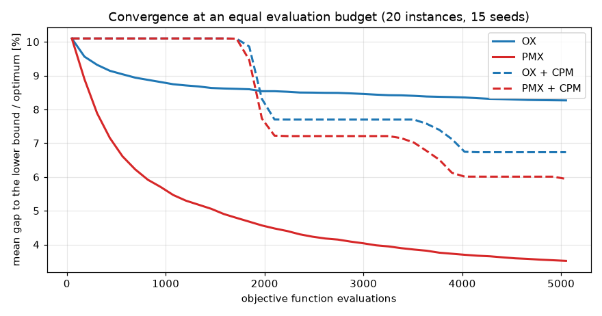

# memetic-task-scheduler

Memetic algorithm (evolutionary algorithm + CPM local search) for multiprocessor
task scheduling with precedence constraints, minimizing makespan (C_max).

## Results

See the final report ([docs/02_final_sn.pdf](docs/02_final_sn.pdf)) for the full
campaign: optimality/lower-bound gaps, the HLFET/MCP baselines, and the Wilcoxon
tests. Solvers are compared at an **equal objective-function evaluation budget**
(not equal generations), which is the methodologically fair comparison. Headline
findings:

- **Pure PMX is the best configuration** at equal budget (best-or-tied on 19/20
  instances). The CPM local search no longer helps the strong PMX operator — its
  advantage under equal *generations* was a budget artifact (memetic variants
  spend ~20–40× more evaluations per generation).
- **H1 is rejected** at equal budget: CPM significantly *hurts* PMX on hard
  graphs (it only helps the weaker OX).
- **H2 is rejected in reverse**: PMX dominates OX, not the other way round.
- Optuna tuning (held-out validation) improves every configuration but does not
  change the ranking; PMX's literature defaults were already near-optimal.



The memetic variants (dashed) spend most of the budget on local search: their
first generation alone costs more than 1500 evaluations, while pure PMX keeps
improving across ~100 cheap generations.

### What changed after the review

The first version of this study (tag
[`graded-2026-06`](https://github.com/p10tr13/memetic-task-scheduler/tree/graded-2026-06))
compared the configurations at an equal number of *generations*. The reviewer
pointed out that this gave the memetic variants a far larger objective-evaluation
budget, so the comparison was not fair, and that the report lacked p-values,
pseudocode and a hyperparameter tuning step. This version counts every objective
evaluation (local search included), compares all solvers at the same budget,
reports raw Wilcoxon p-values, tunes every configuration with Optuna on a held-out
split, and gives pseudocode for each method. Under the fair budget the main
conclusion reversed: the CPM local search does not pay for its cost with PMX.

Reproduce with the commands below.

## Setup

Requires Python 3.10+ (uses PEP 604 `X | None` type unions).

```
python -m venv .venv
source .venv/bin/activate
pip install -r requirements-dev.txt   # runtime dependencies plus pytest, black, pylint
```

## Usage

Run HLFET, MCP, the memetic EA, and the exact MILP on the small bundled instance
and print each makespan with its gap to the MILP optimum:

```
python -m src.main
```

Run the full experiment campaign at the equal evaluation budget, then the
analysis and plots. A campaign writes to a `--name`d (or timestamped) directory
under `results/` (gitignored); each `<instance>__<method>` cell and per-instance
baseline is its own file, so a rerun only refreshes the cells it touches.
`--equal-budget` compares all configs at the pure-EA evaluation budget (instead
of equal generations); `--per-seed` parallelises at the (instance, method, seed)
granularity (1200-way) and merges the sub-cells back into the canonical layout,
which saturates a many-core machine:

```
python -m src.experiments.run_campaign --equal-budget --per-seed --jobs 120 --name eqbudget
python -m src.experiments.analyze --campaign results/eqbudget
python -m src.experiments.plots   --campaign results/eqbudget
```

Run a single (instance, method) configuration directly:

```
python -m src.experiments.run_single --instance syn_t15_p010 --crossover ox --cpm --equal-budget --name run1
```

Tune one configuration with Optuna (held-out split: trains on
`instances.TUNE_INSTANCES`, budget-fair), then validate the tuned vs default
parameters on the held-out instances (H3):

```
python -m src.experiments.tune --crossover pmx --cpm --n-trials 150 \
    --storage results/tune/pmx_cpm.log --out results/tune/pmx_cpm.json
# run a validation campaign with --params-json results/tune/<cfg>.json, then:
python -m src.experiments.analyze --campaign results/tuned --compare-campaign results/eqbudget
```

Regenerate every data-driven figure of the final report from a campaign (run
`analyze` first — it reads `summary.csv`). The default `pgfplots` format writes
the data tables (`docs/figures/data/*.dat`) and self-contained TikZ plot bodies
(`docs/figures/*.tex`) that the report `\input`s; `matplotlib` instead renders
the same figures as PNGs:

```
python -m src.experiments.report_figures --campaign results/eqbudget                               # -> docs/figures/
python -m src.experiments.report_figures --campaign results/eqbudget --figure convergence_evals     # equal-budget convergence
python -m src.experiments.report_figures --campaign results/eqbudget --format matplotlib --outdir /tmp/figs
```

The equal-budget convergence figure (`convergence_evals`) plots best makespan vs
objective evaluations and is opt-in (the default per-generation `convergence_aggregate`
assumes equal-length curves, which equal-budget runs do not produce).

Run the tests:

```
pytest
```

## Hyperparameters

EA search parameters are **global baseline defaults**, not per-instance — a
benchmark instance is a fixed problem, while the search budget is an experiment
knob. They live in `src/experiments/run_single.py` and are overridable on the
command line (`--population`, `--generations`, `--crossover-prob`,
`--mutation-prob`, `--tournament-size`, `--local-search-attempts`, `--seeds`),
or replaced wholesale by a tuned `--params-json` from `tune.py`. These baseline
values were validated against Optuna-tuned parameters (see Results):

| parameter | default | basis |
|---|---|---|
| crossover probability | 0.8 | classic 0.6 (De Jong & Spears 1990) – 0.9 (Grefenstette 1986); DAG-scheduling GAs 0.65–0.95 |
| mutation probability | 0.3 | swap mutation applied *per individual* (not per-bit); permutation GAs 0.1–0.5 |
| population | 50 | De Jong & Spears (50); common range 30–100 |
| evaluation budget | 5050 | `--equal-budget` = pop·(gens+1); the fair, solver-agnostic stop |
| tournament size | 3 | mild selection pressure (Miller & Goldberg 1995) |
| CPM attempts / individual | 20 | local-search budget (memetic variants) |
| independent seeds | 15 | runtime-driven; below the usual 30-run convention — a documented limit on statistical power |

References: De Jong & Spears (1990); Grefenstette (1986), *Optimization of control
parameters for GAs*; Omara & Arafa (2010), *Genetic algorithms for task scheduling
problem*, JPDC 70(1); Hou, Ansari & Ren (1994), IEEE TPDS; Tobita & Kasahara
(2002), Standard Task Graph set.

## Layout

- `src/core/` — domain model, list-scheduling decoder, critical-path (CPM) analysis
- `src/data/` — parser for Kasahara STG instance files
- `src/solvers/evolutionary/` — DEAP-based EA: crossovers (OX, PMX), strategies, CPM local search
- `src/solvers/heuristics.py` — HLFET and MCP list-scheduling baselines
- `src/solvers/milp.py` — exact time-indexed MILP (CBC via PuLP) for small instances, used to report optimality gaps
- `src/main.py` — runs HLFET, MCP, the memetic EA, and the MILP on a small bundled instance and prints each optimality gap
- `src/experiments/` — experiment runners: `instances.py` (benchmark graph registry + the tune/validation split), `run_single.py` (one instance × one EA config → a result cell; `--equal-budget`, `--params-json`, per-seed sub-cells), `run_campaign.py` (the OX/PMX × CPM-on/off matrix over all instances, with per-seed parallelism + merge), `run_baselines.py` (HLFET/MCP/MILP/lower-bound per instance), `tune.py` (Optuna TPE hyperparameter tuning per config), `analyze.py` (Wilcoxon for H1/H2, and H3 tuned-vs-default via `--compare-campaign`), `plots.py` (per-instance boxplots/convergence PNGs for exploration), `report_figures.py` (reproduces the final report's figures as pgfplots `.dat`+`.tex` or matplotlib PNGs), `layout.py` (shared campaign layout)
- `data/` — benchmark task graphs (see `data/README.md`): `kasahara/` (10 real STG graphs spanning size/density), `synthetic/` (10 generated graphs, `make data`), `example.stg` (tiny MILP-demo graph), and `optima.csv` (published makespan references for the Kasahara graphs)
- `tests/` — unit tests
- `docs/` — project reports: `02_final_sn.{tex,pdf}` (final report, Springer template), `02_final_feedback.md` (reviewer feedback the revision addresses), `01_preliminary.{tex,pdf}` (preliminary documentation), and `figures/` (each report chart as its own `\input`-able TikZ file plus generated `data/*.dat`, regenerated by `report_figures.py`; `example.tex` and `_preamble.tex` are hand-authored)

## Authors

Piotr Iśtok and Wojtek Jasiński, Faculty of Mathematics and Information Science, Warsaw University of Technology.

## License

[MIT](LICENSE)
